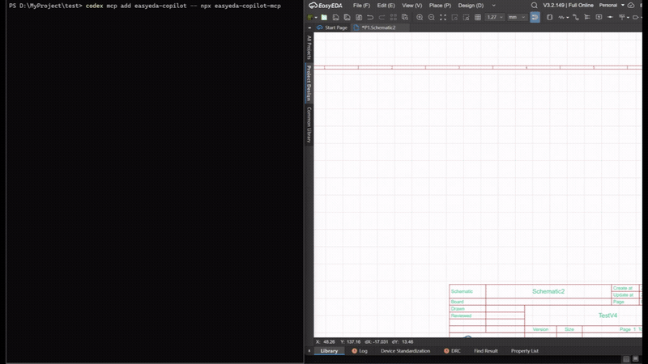
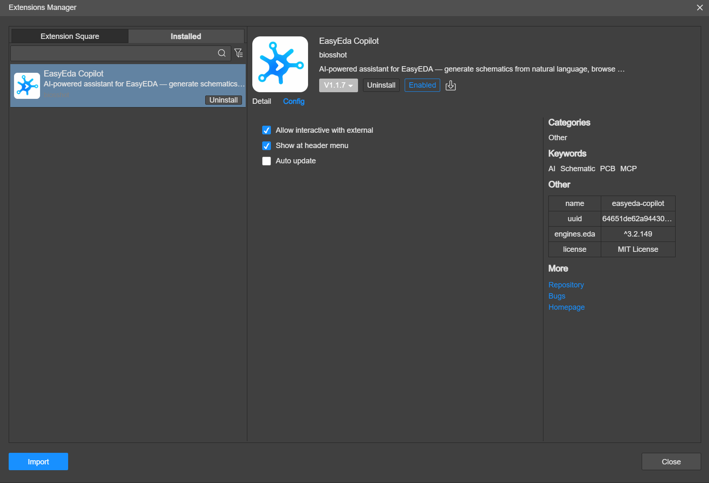

English | [Tiếng Việt](README.vi.md)

#  Easyeda-AI

Chat with Claude inside EasyEDA Pro, using your own Claude subscription, and let it work on your real schematic and PCB documents.

Easyeda-AI is a fork of [EasyEDA Copilot](https://github.com/biosshot/easyeda-copilot) by biosshot. It keeps everything EasyEDA Copilot does (schematic generation and reorganization, component resolution, constraint-driven PCB placement, checkpoint-backed routing, inspection, recovery and native DRC) and adds a **Claude Chat** dialog inside EasyEDA, so you no longer need a terminal or a separate MCP client.

<p align="center">
  <a href="https://github.com/tungpv90/Easyeda-AI/releases/latest">
    
  </a>
  <a href="LICENSE">
    
  </a>
</p>

<p align="center">
  
</p>
<p align="center">
  <sub>Creating and assembling an LDO schematic from a text specification.</sub>
</p>

## Quick start: Claude Chat (Windows)

You need EasyEDA Pro Desktop and a Claude account (Pro or Max subscription, or an Anthropic Console account). You do not need Node.js or a terminal.

1. Download both files from the [latest release](https://github.com/tungpv90/Easyeda-AI/releases/latest):
   - [`easyeda-ai-assistant_v1.3.5.eext`](https://github.com/tungpv90/Easyeda-AI/releases/latest/download/easyeda-ai-assistant_v1.3.5.eext): the EasyEDA extension
   - [`AIChatSetup.exe`](https://github.com/tungpv90/Easyeda-AI/releases/latest/download/AIChatSetup.exe): the local helper installer
2. In EasyEDA Pro, open `Settings → Extensions → Extensions Manager → Import Extensions`, choose the `.eext` file, and enable **External Interactions**.

   <p align="center">
     <a href="docs/media/params.png"></a>
   </p>

3. Double-click `AIChatSetup.exe` once. It:
   - installs Claude Code with Anthropic's official installer if it is missing;
   - copies the helper to `%LOCALAPPDATA%\EasyEDA Copilot\Claude Chat`;
   - starts the helper now and at every Windows login.
4. In EasyEDA Pro, open `AI Assistant → Claude Chat`. If Claude Code is not signed in yet, select **Sign in with Claude** and finish the sign-in in your browser.

Ask in any language, for example "Review this schematic and list wiring mistakes" or "Check the PCB for DRC errors and explain the important ones".

Windows may show "Windows protected your PC" the first time, because the installer is not code-signed. Select **More info → Run anyway**. To update, run the newer `AIChatSetup.exe`. To remove the helper, run `AIChatSetup.exe --uninstall`.

**Upgrading from 1.3.4 ("EasyEda Copilot"):** from 1.3.5 the extension is a separate one named EasyEDA AI Assistant. Remove the old extension in the Extensions Manager, import the new `.eext` and enable **External Interactions** again. `AIChatSetup.exe` updates the helper installed by `ClaudeChatSetup.exe`.

### What the dialog does

- Streams Claude's replies and shows each EasyEDA tool call with its result.
- Runs the EasyEDA tools without prompts. Document changes are checkpoint-backed and can be restored.
- Asks **Allow / Always allow / Deny** before anything else, such as fetching a web page.
- Shows your 5-hour and 7-day subscription usage, and lets you stop a reply or start a new conversation.
- Lists the models your Claude account can use (Opus, Sonnet, Fable, Haiku and older versions), with each model's ID, context window, output limit and API price, and lets you choose the effort level.
- Keeps a history of your conversations. Open an earlier one to continue it: Claude remembers what was said.
- Attach images, PDFs (for example datasheets) and text files such as netlists with 📎, by pasting a screenshot, or by dropping files on the dialog.
- Cannot run shell commands or edit files on your computer.

### Why a separate installer

EasyEDA extensions run in a sandbox and cannot start programs. The helper runs your own Claude Code installation in the background and connects it to the dialog. It uses Claude Code's sign-in and never reads or stores your Claude credentials.

Details, settings and troubleshooting: [docs/claude-chat.md](docs/claude-chat.md).

## Alternative: use your own MCP client

You can also drive EasyEDA from Claude Code, Codex or another MCP client in a terminal, as in upstream EasyEDA Copilot.

**Claude Code:** `AIChatSetup.exe` already added the `easyeda-ai-assistant` MCP server to your Claude Code, so new sessions in a terminal or VS Code have the EasyEDA tools. Nothing else to install.

Without the installer, or for another client, install the `.eext` as above, then add the MCP server (requires Node.js >= 20.19):

```bash
claude mcp add easyeda-copilot -- npx -y easyeda-copilot-mcp
# or
codex mcp add easyeda-copilot -- npx -y easyeda-copilot-mcp
```

`npx easyeda-copilot-mcp` installs the published upstream package. It provides the same EasyEDA tools; only the Claude Chat helper is specific to this fork. For generic MCP configuration, local builds and the standalone skill, see the [MCP package documentation](mcp/README.md) and the [skill installation guide](mcp/docs/install-guide.md).

Open EasyEDA Pro and the target document, then ask the agent to inspect the open project. The extension finds the local MCP bridge by itself; `AI Assistant → MCP` pauses or resumes the connection.

## Demonstrations

These videos come from upstream EasyEDA Copilot. They use the same tools that Claude Chat uses. Every result stays editable as a normal EasyEDA project.

<details>
<summary><strong>BGA2869 2 GHz RF amplifier</strong>: schematic organization, signal-path constraints, compact placement, routing, ground planes and via stitching</summary>

<video controls preload="metadata" width="100%">
  <source src="https://github.com/user-attachments/assets/b3b3b25a-bc27-4654-8802-23775ff71735" type="video/mp4">
  <a href="https://github.com/user-attachments/assets/b3b3b25a-bc27-4654-8802-23775ff71735">Watch this video</a>
</video>

[Open video separately](https://github.com/user-attachments/assets/b3b3b25a-bc27-4654-8802-23775ff71735)

</details>

<details>
<summary><strong>ESP32-C3 controller</strong>: multi-page schematic, power conversion, USB, CAN, RS-485, antenna constraints, routing and DRC-driven repair</summary>

<video controls preload="metadata" width="100%">
  <source src="https://github.com/user-attachments/assets/df1dd4e2-ee48-492c-badb-de2dc220ae41" type="video/mp4">
  <a href="https://github.com/user-attachments/assets/df1dd4e2-ee48-492c-badb-de2dc220ae41">Watch this video</a>
</video>

[Open video separately](https://github.com/user-attachments/assets/df1dd4e2-ee48-492c-badb-de2dc220ae41)

</details>

<details>
<summary><strong>MIMXRT1011 controller</strong>: dense four-layer board around a high-pin-count MCU</summary>

<video controls preload="metadata" width="100%">
  <source src="https://github.com/user-attachments/assets/757690b8-83cd-42c7-b88f-4db9ba2df010" type="video/mp4">
  <a href="https://github.com/user-attachments/assets/757690b8-83cd-42c7-b88f-4db9ba2df010">Watch this video</a>
</video>

[Open video separately](https://github.com/user-attachments/assets/757690b8-83cd-42c7-b88f-4db9ba2df010)

</details>

<details>
<summary><strong>Schematic beautification</strong>: reorganize an existing page into named functional blocks</summary>

<video controls preload="metadata" width="100%">
  <source src="https://github.com/user-attachments/assets/d77218e5-4f6f-42b8-bea4-7f7240f8f7f3" type="video/mp4">
  <a href="https://github.com/user-attachments/assets/d77218e5-4f6f-42b8-bea4-7f7240f8f7f3">Watch this video</a>
</video>

[Open video separately](https://github.com/user-attachments/assets/d77218e5-4f6f-42b8-bea4-7f7240f8f7f3)

</details>

More editable examples are available on [OSHWLab](https://oshwlab.com/biosshot/edacopilotexamples).

## Capabilities

| Area            | Capabilities                                                                                                                                                                                                 |
| --------------- | ------------------------------------------------------------------------------------------------------------------------------------------------------------------------------------------------------------ |
| Chat in EasyEDA | Claude Chat dialog with your Claude subscription, streaming replies, tool activity, permission prompts and usage display                                                                                      |
| Schematics      | Inspect the current page, create and complete circuits, reorganize existing schematics into functional blocks, and annotate designators across multiple pages                                                |
| Components      | Resolve EasyEDA components by manufacturer MPN or part UUID                                                                                                                                                  |
| PCB placement   | Generate board geometry and constraint-driven placement using functional blocks, modules, pin proximity, ordered signal paths, edge placement, keepouts, mounting holes, thermal pads, and preserved objects |
| PCB routing     | Define net classes, signal and power nets, copper planes, differential pairs, matched groups, fanout, impedance intent, selective rerouting, and via stitching                                               |
| Inspection      | Render layer-aware PCB previews, highlight nets and components, and inspect routed length, track widths, layers, vias, pads, polygons, nearby components, and unrouted connections                           |
| Verification    | Read current DRC rules, run native EasyEDA DRC, inspect violations, and choose whether to keep, repair, or restore an applied result                                                                         |
| Project control | Inspect project trees, create and open projects or documents, synchronize editors, and select between multiple connected EasyEDA instances                                                                   |
| Long operations | Monitor, continue, reapply prepared results, or cancel long PCB placement and routing operations                                                                                                             |

## Checkpoints, transactions, and recovery

Changes are previewed, applied to native EasyEDA documents, inspected, and then kept, repaired, or restored. Checkpoints contain the complete EasyEDA document source, not only a list of agent actions.

| Workflow                        | Protection and recovery behavior                                                                                                                  |
| ------------------------------- | ------------------------------------------------------------------------------------------------------------------------------------------------- |
| Source-based schematic assembly | Saves a full document checkpoint before modification and restores it automatically if assembly fails                                              |
| Schematic beautification        | Saves a checkpoint before page replacement and restores it automatically if replacement fails                                                     |
| Multi-page annotation           | Saves a checkpoint for every affected page and rolls modified pages back if the annotation transaction fails                                      |
| PCB placement                   | Produces mechanical and final previews, preserves existing board work, and saves a checkpoint before assembly                                     |
| PCB routing                     | Applies DRC rules, selected copper replacement, new tracks, vias, zones, synchronization, and native DRC inside one checkpoint-backed transaction |
| Routing application failure     | Restores the pre-routing checkpoint automatically                                                                                                 |
| Manual recovery                 | Lists, saves, and restores checkpoints explicitly for the current EasyEDA document                                                                |

Existing tracks, vias, and copper zones are preserved by default and treated as fixed routing obstacles. Copper is replaced only when a routing program explicitly selects the affected nets and object types through `clearRouting(...)`. Recovery protects the document from failed changes; electrical and manufacturability review remains part of the normal engineering workflow.

## Schematic and PCB workflows

Schematic work:

1. Inspect the current project and schematic page.
2. Resolve exact components and save a checkpoint.
3. Create a circuit, complete an existing fragment, replace components, or reorganize the page into named functional blocks.
4. Apply the result to the EasyEDA document, inspect it, then keep, revise, or restore it.

PCB work:

1. Synchronize the schematic with its PCB and inspect schematic groups, board outline, footprints, layers and DRC rules.
2. Describe mechanical, functional and electrical intent in the placement DSL; review the previews; assemble the approved placement.
3. Define stack, rules, net classes, planes, special nets, fanout and via stitching in the routing DSL; apply it as one checkpoint-backed transaction.
4. Inspect critical nets, remaining connections, copper and native DRC; keep, repair, or restore.

References: [PCB placement instructions](mcp/docs/pcb-layout/instructions.md), [placement DSL](mcp/docs/pcb-layout/dsl.ts), [mechanical validation](mcp/docs/pcb-layout/mechanical-validation.md), [PCB routing instructions](mcp/docs/pcb-routing/instructions.md), [routing DSL](mcp/docs/pcb-routing/dsl.ts), [verification and recovery](mcp/docs/verification.md).

## Architecture

```text
Claude Chat dialog (EasyEDA)                      Claude Code / Codex / other MCP client
        |                                                        |
        | WebSocket 127.0.0.1:8788                               | stdio
        v                                                        |
Claude Chat helper ── runs ──> claude -p (your sign-in)          |
        |                            |                           |
        |                            | stdio                     |
        |                            v                           v
        |                     easyeda-copilot MCP server <───────┘
        |                            |
        └──── WebSocket 127.0.0.1:8787 (bridge) ────┐
                                                    v
                                     EasyEDA Copilot extension ──> open EasyEDA document
```

- The helper accepts connections only from EasyEDA (checked by `Origin` and `Host`), so web pages cannot drive Claude on your computer.
- The MCP bridge talks to the extension only on `127.0.0.1`.
- Components are resolved and placement plans are generated locally by the [`eda-copilot-backend`](https://github.com/biosshot/eda-copilot-backend) library; routing uses [`eda-copilot-router`](https://github.com/biosshot/eda-copilot-router).

## Compatibility

| Component             | Status                                                            |
| --------------------- | ----------------------------------------------------------------- |
| EasyEDA Pro Desktop   | V3.2.209 used with Claude Chat; V3.2.149, V2.2.47 and V2.2.45 verified upstream |
| Claude Chat installer | Windows x64. On macOS and Linux, run the helper from source (see below) |
| Claude Code           | Tested with 2.1.314                                               |

## Building from source

Requires Node.js ^20.19.0 or >= 22.12.0.

```bash
git clone https://github.com/tungpv90/Easyeda-AI.git
cd Easyeda-AI
npm ci
npm run build              # extension  -> build/dist/easyeda-ai-assistant_v1.3.5.eext
npm run build:installer    # helper     -> build/dist/AIChatSetup.exe (Windows)
npm run check --workspace=mcp
```

- On macOS, Linux, or during development, run the helper with Node instead of the installer: `node mcp/dist/index.js chat --install`, or `node mcp/dist/index.js chat` to keep it in the foreground.
- Source layout: `extension/` (EasyEDA extension and dialogs), `mcp/` (MCP server and the Claude Chat helper in `mcp/src/chat/`), `installer/` (Windows installer), `shared/` (shared types).
- More detail: [extension development](extension/README.md), [local development](docs/local-development.md), [documentation index](docs/README.md).

## Terms

The helper drives the Claude Code CLI that each user installs and signs in to themselves. Use follows [Anthropic's terms](https://www.anthropic.com/legal). If you redistribute this as a product for other people, check those terms first: third-party products are generally expected to use API-key authentication rather than offer claude.ai sign-in.

## Credits and license

Built on [EasyEDA Copilot](https://github.com/biosshot/easyeda-copilot) by biosshot. Upstream community: [Discord](https://discord.gg/AXCGjTDYkq); to support upstream development: [Tribute](https://web.tribute.tg/d/PTf). Translated upstream READMEs ([简体中文](README.zh-CN.md), [Русский](README.ru.md), [Español](README.es.md)) do not yet cover Claude Chat.

Distributed under the [MIT License](LICENSE).
