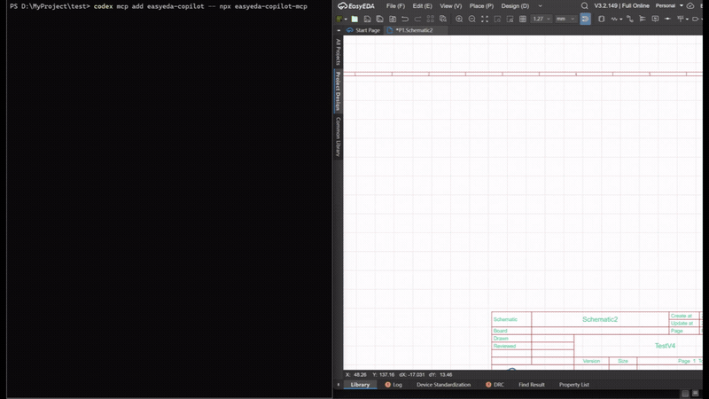
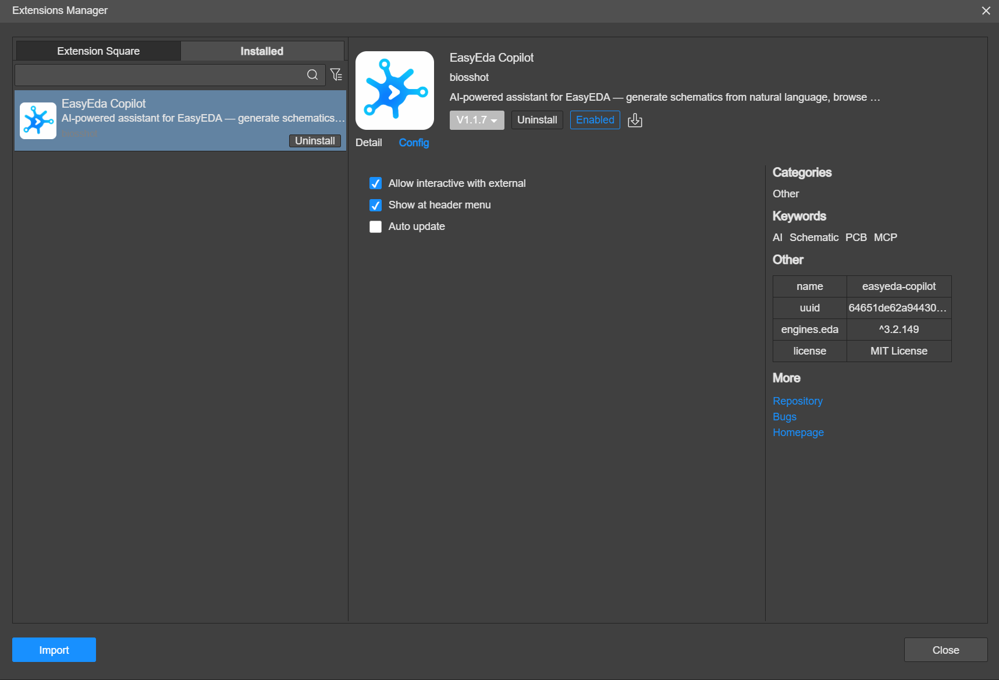

[English](README.md) | Tiếng Việt

#  Easyeda-AI

Chat với Claude ngay trong EasyEDA Pro bằng gói Claude của chính bạn, và để Claude làm việc trực tiếp trên sơ đồ nguyên lý và mạch in thật của bạn.

Easyeda-AI là bản fork của [EasyEDA Copilot](https://github.com/biosshot/easyeda-copilot) (tác giả biosshot). Bản fork giữ nguyên mọi tính năng của EasyEDA Copilot: tạo và sắp xếp lại sơ đồ nguyên lý, tra linh kiện, xếp linh kiện PCB theo ràng buộc, đi dây có checkpoint, kiểm tra, khôi phục và DRC gốc của EasyEDA. Điểm mới là hộp thoại **Claude Chat** ngay trong EasyEDA, nên không cần mở terminal hay cài MCP client riêng.

<p align="center">
  <a href="https://github.com/tungpv90/Easyeda-AI/releases/latest">
    
  </a>
  <a href="LICENSE">
    
  </a>
</p>

<p align="center">
  
</p>
<p align="center">
  <sub>Tạo và lắp sơ đồ LDO từ mô tả bằng chữ.</sub>
</p>

## Bắt đầu nhanh: Claude Chat (Windows)

Cần có EasyEDA Pro Desktop và một tài khoản Claude: gói Pro hoặc Max, hoặc tài khoản Anthropic Console. Không cần Node.js, không cần terminal.

1. Tải hai file trong [bản phát hành mới nhất](https://github.com/tungpv90/Easyeda-AI/releases/latest):
   - [`easyeda-copilot_v1.3.4.eext`](https://github.com/tungpv90/Easyeda-AI/releases/latest/download/easyeda-copilot_v1.3.4.eext): extension cho EasyEDA
   - [`ClaudeChatSetup.exe`](https://github.com/tungpv90/Easyeda-AI/releases/latest/download/ClaudeChatSetup.exe): trình cài helper chạy trên máy
2. Trong EasyEDA Pro, vào `Settings → Extensions → Extensions Manager → Import Extensions`, chọn file `.eext`, rồi bật **External Interactions**.

   <p align="center">
     <a href="docs/media/params.png"></a>
   </p>

3. Bấm đúp `ClaudeChatSetup.exe` **một lần**. Trình cài đặt sẽ:
   - cài Claude Code bằng trình cài chính thức của Anthropic nếu máy chưa có;
   - chép helper vào `%LOCALAPPDATA%\EasyEDA Copilot\Claude Chat`;
   - bật helper ngay, và cho nó tự chạy mỗi khi đăng nhập Windows.
4. Trong EasyEDA Pro, mở `Copilot → Claude Chat`. Nếu Claude Code chưa đăng nhập, bấm **Sign in with Claude** rồi đăng nhập trên trình duyệt.

Hỏi bằng tiếng Việt cũng được, ví dụ: "Rà soát sơ đồ này và liệt kê các lỗi nối dây" hoặc "Kiểm tra DRC của PCB và giải thích các lỗi quan trọng".

Lần đầu chạy, Windows có thể báo "Windows protected your PC" vì trình cài đặt chưa được ký số. Bấm **More info → Run anyway**. Muốn cập nhật thì chạy `ClaudeChatSetup.exe` bản mới hơn. Muốn gỡ helper thì chạy `ClaudeChatSetup.exe --uninstall`.

### Hộp thoại làm được gì

- Hiện câu trả lời của Claude theo thời gian thực, kèm từng lần gọi tool EasyEDA và kết quả.
- Chạy các tool EasyEDA mà không hỏi lại. Mọi thay đổi trên tài liệu đều có checkpoint để khôi phục.
- Hỏi **Allow / Always allow / Deny** trước mọi thao tác khác, ví dụ tải một trang web.
- Hiện mức dùng gói Claude trong 5 giờ và 7 ngày. Cho dừng câu trả lời hoặc bắt đầu cuộc trò chuyện mới.
- Liệt kê các model mà tài khoản Claude của bạn dùng được (Opus, Sonnet, Fable, Haiku và các phiên bản cũ hơn), kèm ID, context window, giới hạn output và giá API của từng model. Cho chọn mức effort.
- Lưu lịch sử các cuộc trò chuyện. Mở lại một cuộc trò chuyện cũ để nói tiếp: Claude vẫn nhớ những gì đã trao đổi.
- Đính kèm ảnh, PDF (ví dụ datasheet) và file văn bản như netlist bằng nút 📎, bằng cách dán ảnh chụp màn hình, hoặc kéo thả file vào hộp thoại.
- Không chạy được lệnh shell và không sửa được file trên máy bạn.

### Vì sao cần trình cài đặt riêng

Extension của EasyEDA chạy trong sandbox, không tự khởi động được chương trình nào. Helper chạy Claude Code của chính bạn ở chế độ nền và nối nó với hộp thoại. Helper dùng phiên đăng nhập của Claude Code, không bao giờ đọc hay lưu thông tin đăng nhập Claude của bạn.

Chi tiết, cấu hình và cách xử lý sự cố: [docs/claude-chat.md](docs/claude-chat.md) (tiếng Anh).

## Cách khác: dùng MCP client của bạn

Bạn vẫn có thể điều khiển EasyEDA từ Claude Code, Codex hoặc MCP client khác trong terminal, như EasyEDA Copilot gốc. Cài `.eext` như trên, rồi thêm MCP server (cần Node.js >= 20.19):

```bash
claude mcp add easyeda-copilot -- npx -y easyeda-copilot-mcp
# hoặc
codex mcp add easyeda-copilot -- npx -y easyeda-copilot-mcp
```

`npx easyeda-copilot-mcp` cài gói đã phát hành của bản gốc. Gói này có đủ các tool EasyEDA; riêng helper Claude Chat chỉ có trong bản fork này. Cấu hình MCP chung, build cục bộ và skill độc lập: xem [tài liệu gói MCP](mcp/README.md) và [hướng dẫn cài skill](mcp/docs/install-guide.md).

Mở EasyEDA Pro và tài liệu cần làm, rồi bảo agent kiểm tra project đang mở. Extension tự tìm MCP bridge trên máy; `Copilot → MCP` dùng để tạm dừng hoặc bật lại kết nối.

## Video minh hoạ

Các video dưới đây lấy từ EasyEDA Copilot gốc. Claude Chat dùng đúng các tool này. Mọi kết quả đều là project EasyEDA bình thường, sửa tiếp được.

<details>
<summary><strong>Bộ khuếch đại RF BGA2869 2 GHz</strong>: sắp xếp sơ đồ, ràng buộc đường tín hiệu, xếp linh kiện gọn, đi dây, mặt đồng GND và khâu via</summary>

<video controls preload="metadata" width="100%">
  <source src="https://github.com/user-attachments/assets/b3b3b25a-bc27-4654-8802-23775ff71735" type="video/mp4">
  <a href="https://github.com/user-attachments/assets/b3b3b25a-bc27-4654-8802-23775ff71735">Xem video</a>
</video>

[Mở video riêng](https://github.com/user-attachments/assets/b3b3b25a-bc27-4654-8802-23775ff71735)

</details>

<details>
<summary><strong>Bo điều khiển ESP32-C3</strong>: sơ đồ nhiều trang, nguồn, USB, CAN, RS-485, ràng buộc anten, đi dây và sửa lỗi theo DRC</summary>

<video controls preload="metadata" width="100%">
  <source src="https://github.com/user-attachments/assets/df1dd4e2-ee48-492c-badb-de2dc220ae41" type="video/mp4">
  <a href="https://github.com/user-attachments/assets/df1dd4e2-ee48-492c-badb-de2dc220ae41">Xem video</a>
</video>

[Mở video riêng](https://github.com/user-attachments/assets/df1dd4e2-ee48-492c-badb-de2dc220ae41)

</details>

<details>
<summary><strong>Bo điều khiển MIMXRT1011</strong>: bo 4 lớp dày đặc quanh một MCU nhiều chân</summary>

<video controls preload="metadata" width="100%">
  <source src="https://github.com/user-attachments/assets/757690b8-83cd-42c7-b88f-4db9ba2df010" type="video/mp4">
  <a href="https://github.com/user-attachments/assets/757690b8-83cd-42c7-b88f-4db9ba2df010">Xem video</a>
</video>

[Mở video riêng](https://github.com/user-attachments/assets/757690b8-83cd-42c7-b88f-4db9ba2df010)

</details>

<details>
<summary><strong>Làm đẹp sơ đồ nguyên lý</strong>: sắp xếp lại một trang có sẵn thành các khối chức năng có tên</summary>

<video controls preload="metadata" width="100%">
  <source src="https://github.com/user-attachments/assets/d77218e5-4f6f-42b8-bea4-7f7240f8f7f3" type="video/mp4">
  <a href="https://github.com/user-attachments/assets/d77218e5-4f6f-42b8-bea4-7f7240f8f7f3">Xem video</a>
</video>

[Mở video riêng](https://github.com/user-attachments/assets/d77218e5-4f6f-42b8-bea4-7f7240f8f7f3)

</details>

Thêm ví dụ có thể sửa trên [OSHWLab](https://oshwlab.com/biosshot/edacopilotexamples).

## Tính năng

| Lĩnh vực           | Tính năng                                                                                                                                                    |
| ------------------ | ------------------------------------------------------------------------------------------------------------------------------------------------------------ |
| Chat trong EasyEDA | Hộp thoại Claude Chat dùng gói Claude của bạn: trả lời theo thời gian thực, hiện hoạt động của tool, hỏi quyền, hiện mức dùng                                 |
| Sơ đồ nguyên lý    | Đọc trang hiện tại, tạo và hoàn thiện mạch, sắp xếp sơ đồ thành khối chức năng, đánh số designator trên nhiều trang                                           |
| Linh kiện          | Tra linh kiện EasyEDA theo mã MPN của nhà sản xuất hoặc UUID                                                                                                 |
| Xếp linh kiện PCB  | Tạo hình bo và xếp linh kiện theo ràng buộc: khối chức năng, module, chân gần nhau, thứ tự đường tín hiệu, sát mép bo, vùng cấm, lỗ bắt vít, pad tản nhiệt, giữ nguyên đối tượng có sẵn |
| Đi dây PCB         | Net class, net tín hiệu và nguồn, mặt đồng, cặp vi sai, nhóm cân chiều dài, fanout, trở kháng, đi lại dây có chọn lọc, khâu via                              |
| Kiểm tra           | Ảnh xem trước PCB theo lớp, làm nổi net và linh kiện, đo chiều dài dây, độ rộng dây, lớp, via, pad, polygon, linh kiện lân cận và kết nối chưa đi              |
| Xác minh           | Đọc luật DRC, chạy DRC gốc của EasyEDA, xem lỗi, và chọn giữ, sửa hay khôi phục kết quả                                                                     |
| Quản lý project    | Xem cây project, tạo và mở project hoặc tài liệu, đồng bộ editor, chọn giữa nhiều cửa sổ EasyEDA đang kết nối                                                |
| Tác vụ dài         | Theo dõi, tiếp tục, áp dụng lại kết quả đã chuẩn bị, hoặc huỷ các tác vụ xếp linh kiện và đi dây PCB kéo dài                                                 |

## Checkpoint và khôi phục

Mọi thay đổi đều được xem trước, áp vào tài liệu EasyEDA, kiểm tra, rồi mới giữ, sửa hoặc khôi phục. Checkpoint chứa toàn bộ nguồn của tài liệu EasyEDA, không chỉ danh sách thao tác của agent.

| Quy trình                       | Bảo vệ và khôi phục                                                                                                   |
| ------------------------------- | --------------------------------------------------------------------------------------------------------------------- |
| Lắp sơ đồ từ nguồn              | Lưu checkpoint toàn tài liệu trước khi sửa, tự khôi phục nếu lắp thất bại                                              |
| Làm đẹp sơ đồ                   | Lưu checkpoint trước khi thay trang, tự khôi phục nếu thay thất bại                                                    |
| Đánh số nhiều trang             | Lưu checkpoint cho mỗi trang bị ảnh hưởng, hoàn tác các trang đã sửa nếu thất bại                                      |
| Xếp linh kiện PCB               | Tạo ảnh xem trước cơ khí và bản cuối, giữ phần bo có sẵn, lưu checkpoint trước khi lắp                                 |
| Đi dây PCB                      | Luật DRC, thay đồng có chọn lọc, dây mới, via, vùng đồng, đồng bộ và DRC gốc gói trong một giao dịch có checkpoint      |
| Đi dây thất bại                 | Tự khôi phục checkpoint trước khi đi dây                                                                              |
| Khôi phục thủ công              | Liệt kê, lưu và khôi phục checkpoint cho tài liệu đang mở                                                             |

Dây, via và vùng đồng có sẵn được giữ nguyên mặc định và coi là vật cản cố định khi đi dây. Đồng chỉ bị thay khi chương trình đi dây chọn rõ net và loại đối tượng qua `clearRouting(...)`. Khôi phục chỉ bảo vệ tài liệu khỏi các thay đổi thất bại; việc rà soát điện và khả năng sản xuất vẫn là phần việc kỹ thuật bình thường.

## Quy trình sơ đồ và PCB

Sơ đồ nguyên lý:

1. Đọc project và trang sơ đồ hiện tại.
2. Tra đúng linh kiện và lưu checkpoint.
3. Tạo mạch, hoàn thiện một phần mạch có sẵn, thay linh kiện, hoặc sắp xếp trang thành các khối chức năng có tên.
4. Áp kết quả vào tài liệu EasyEDA, kiểm tra, rồi giữ, sửa tiếp hoặc khôi phục.

PCB:

1. Đồng bộ sơ đồ với PCB; xem nhóm sơ đồ, viền bo, footprint, các lớp và luật DRC.
2. Mô tả ý đồ cơ khí, chức năng và điện bằng DSL xếp linh kiện; xem ảnh xem trước; lắp phương án đã duyệt.
3. Khai báo stack lớp, luật, net class, mặt đồng, net đặc biệt, fanout và khâu via bằng DSL đi dây; áp dụng trong một giao dịch có checkpoint.
4. Kiểm tra net quan trọng, kết nối còn thiếu, đồng và DRC gốc; rồi giữ, sửa hoặc khôi phục.

Tài liệu tham khảo (tiếng Anh): [hướng dẫn xếp linh kiện PCB](mcp/docs/pcb-layout/instructions.md), [DSL xếp linh kiện](mcp/docs/pcb-layout/dsl.ts), [kiểm tra cơ khí](mcp/docs/pcb-layout/mechanical-validation.md), [hướng dẫn đi dây PCB](mcp/docs/pcb-routing/instructions.md), [DSL đi dây](mcp/docs/pcb-routing/dsl.ts), [xác minh và khôi phục](mcp/docs/verification.md).

## Kiến trúc

```text
Hộp thoại Claude Chat (EasyEDA)                   Claude Code / Codex / MCP client khác
        |                                                        |
        | WebSocket 127.0.0.1:8788                               | stdio
        v                                                        |
Helper Claude Chat ── chạy ──> claude -p (đăng nhập của bạn)     |
        |                            |                           |
        |                            | stdio                     |
        |                            v                           v
        |                     MCP server easyeda-copilot <───────┘
        |                            |
        └──── WebSocket 127.0.0.1:8787 (bridge) ────┐
                                                    v
                                     Extension EasyEDA Copilot ──> tài liệu EasyEDA đang mở
```

- Helper chỉ nhận kết nối từ EasyEDA (kiểm tra `Origin` và `Host`), nên trang web lạ không điều khiển được Claude trên máy bạn.
- MCP bridge chỉ nói chuyện với extension qua `127.0.0.1`.
- Tra linh kiện và lập phương án xếp linh kiện chạy ngay trên máy bằng thư viện [`eda-copilot-backend`](https://github.com/biosshot/eda-copilot-backend); đi dây dùng [`eda-copilot-router`](https://github.com/biosshot/eda-copilot-router).

## Tương thích

| Thành phần                | Trạng thái                                                                       |
| ------------------------- | -------------------------------------------------------------------------------- |
| EasyEDA Pro Desktop       | Đã dùng V3.2.209 với Claude Chat; V3.2.149, V2.2.47 và V2.2.45 được bản gốc xác nhận |
| Trình cài Claude Chat     | Windows x64. Trên macOS và Linux, chạy helper từ mã nguồn (xem bên dưới)           |
| Claude Code               | Đã thử với 2.1.314                                                               |

## Build từ mã nguồn

Cần Node.js ^20.19.0 hoặc >= 22.12.0.

```bash
git clone https://github.com/tungpv90/Easyeda-AI.git
cd Easyeda-AI
npm ci
npm run build              # extension  -> build/dist/easyeda-copilot_v1.3.4.eext
npm run build:installer    # helper     -> build/dist/ClaudeChatSetup.exe (Windows)
npm run check --workspace=mcp
```

- Trên macOS, Linux hoặc khi phát triển, chạy helper bằng Node thay cho trình cài đặt: `node mcp/dist/index.js chat --install`, hoặc `node mcp/dist/index.js chat` để chạy ở cửa sổ hiện tại.
- Cấu trúc mã nguồn: `extension/` (extension và các hộp thoại EasyEDA), `mcp/` (MCP server, helper Claude Chat ở `mcp/src/chat/`), `installer/` (trình cài Windows), `shared/` (kiểu dữ liệu dùng chung).
- Thêm chi tiết (tiếng Anh): [phát triển extension](extension/README.md), [phát triển cục bộ](docs/local-development.md), [mục lục tài liệu](docs/README.md).

## Điều khoản

Helper điều khiển Claude Code mà mỗi người dùng tự cài và tự đăng nhập. Việc sử dụng tuân theo [điều khoản của Anthropic](https://www.anthropic.com/legal). Nếu bạn phát hành lại phần mềm này như một sản phẩm cho người khác, hãy đọc kỹ các điều khoản đó trước: sản phẩm của bên thứ ba thường phải dùng xác thực bằng API key thay vì cho đăng nhập bằng tài khoản claude.ai.

## Ghi công và giấy phép

Xây dựng trên [EasyEDA Copilot](https://github.com/biosshot/easyeda-copilot) của biosshot. Cộng đồng của bản gốc: [Discord](https://discord.gg/AXCGjTDYkq); ủng hộ tác giả gốc: [Tribute](https://web.tribute.tg/d/PTf). Các README dịch của bản gốc ([简体中文](README.zh-CN.md), [Русский](README.ru.md), [Español](README.es.md)) chưa có phần Claude Chat.

Phát hành theo [giấy phép MIT](LICENSE).
